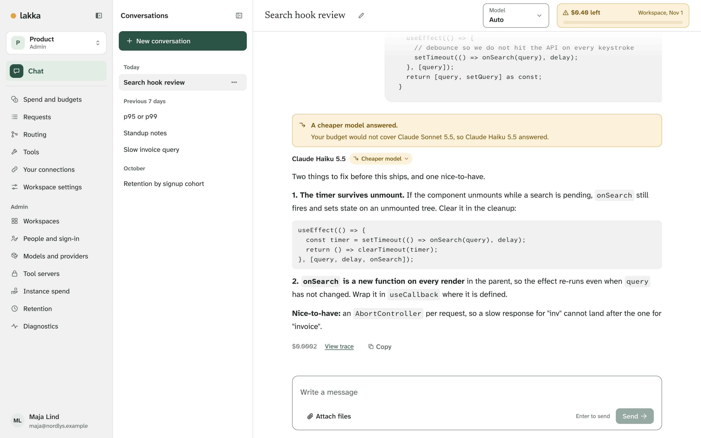

# Lakka

Lakka is a self-hosted AI control plane for teams of 10 to 50 people: one install, your own model keys, and one identity and policy model applied across web chat, an OpenAI-compatible API and MCP. Spend cannot exceed a cap, every request is attributed and traced, and a tool can never do what the requesting user is not allowed to do.

You do not have to use Lakka's chat. Any app, coding harness or script that speaks the OpenAI
Chat Completions API can point at Lakka with a Lakka key instead, and its requests get the same
caps, traces and permissions. Ask for the model `auto` and the workspace's routes pick the model
for each request, using a classifier that runs offline inside the image. [The API](docs/guide/api.md)
has the details.

<picture>
  <source media="(prefers-color-scheme: dark)" srcset="docs/guide/tour/chat-cheaper-model-dark.webp">
  
</picture>

[A tour of Lakka](https://lakka-ai.github.io/lakka/guide/tour) shows the rest: routing, caps,
traces, spend and tools that ask first, from a demo install.

Status: the v1 milestones are done; [`docs/roadmap.md`](docs/roadmap.md) lists them and their
gates. The latest release,
[v1.0.0-beta.4](https://github.com/lakka-ai/lakka/releases/tag/v1.0.0-beta.4), is a beta;
[`docs/releasing.md`](docs/releasing.md) describes how a release is made.

## Run it

You need Docker Engine 26 or later (Docker Desktop 4.29 or later) with Compose v2.20 or later.
From a release bundle or a checkout of this repository:

```
docker compose up -d --wait
```

Open http://localhost:8080 and follow the setup steps; the setup code comes from
`docker compose exec api lakka setup-code`. **The guide in [`docs/guide/`](docs/guide/README.md)
covers everything else**: serving it on a domain with HTTPS, administration, the API, every
setting, backups, upgrades and troubleshooting.

To report a security problem, see [`SECURITY.md`](SECURITY.md). To contribute, see
[`CONTRIBUTING.md`](CONTRIBUTING.md): changes are signed off under the DCO, with no CLA.

## Develop

You need Node.js 24 (the exact version is in `.nvmrc`), pnpm 12 (the exact version is in
`package.json`; `corepack enable pnpm` picks it up), and Docker, for Postgres and Valkey.

Day to day:

```
pnpm install
pnpm dev                 # Postgres and Valkey in containers; api, web and worker in watch mode
pnpm setup-code          # the first-run setup code, at http://localhost:5173 under pnpm dev
pnpm typecheck
pnpm lint                # oxlint
pnpm format              # oxfmt, writes; pnpm format:check only checks
pnpm check:copy          # banned characters in web UI and site text
pnpm stories             # the pattern gallery (Storybook) on port 6006
pnpm site:dev            # the project site, the landing page and the guide, on port 5173
pnpm site:build          # the static site into apps/site/.vitepress/dist
pnpm site:preview        # the built site on port 4173
pnpm db:generate         # new migration from schema changes (drizzle-kit)
pnpm db:migrate          # apply migrations to the dev database; --verify only checks
pnpm models:fetch        # download the pinned classifier model into models/
```

Tests:

```
pnpm test                # unit tests: no network, no services
pnpm test:integration    # integration tests against real Postgres and Valkey in containers
pnpm test:stories        # every story: axe, light and dark, desktop and 390px
pnpm site:check          # the site: links and anchors, no third-party requests, every page at ten sizes in three browser engines, light and dark, menus, search, keyboard
pnpm test:e2e            # Playwright acceptance suite; start the stack with the fake provider first (docker compose -f compose.yaml -f docker/compose.e2e.yaml up -d --wait)
pnpm test:compat         # the official TypeScript SDK against that same stack
pnpm test:compat:python  # the official Python SDK, from a python container, after test:compat
pnpm test:compat:apps    # unmodified Open WebUI and LibreChat against the stack, after test:compat
pnpm test:sandbox        # a probe stdio server in that same stack's sandbox, and what it cannot reach
pnpm classifier:eval     # the routing evaluation set against the bundled model; --tune searches thresholds
```

CI and release:

```
pnpm ci:local            # the CI jobs on this machine, from a clean clone of the current commit
pnpm check:dco           # every commit on this branch signed off by its author (DCO)
pnpm lint:workflows      # actionlint on .github/workflows
pnpm scan                # Trivy on the lockfile and any images given
pnpm test:out-of-process # a tool in the locked-down runner container; needs LAKKA_RUNNER_IMAGE
pnpm test:bundle         # first-run, cold start and offline start from a release bundle
pnpm test:upgrade        # the previous release upgraded in place to the current commit
pnpm release:bundle      # the release bundle, every image pinned by digest
pnpm catalogue:update    # regenerate the model catalogue from LiteLLM prices; review the diff
pnpm catalogue:keygen    # a price feed signing key pair; the private key goes outside the repo (owner only)
pnpm catalogue:sign      # sign the catalogue as feed/catalogue-v1.json with LAKKA_FEED_SIGNING_KEY (owner only)
```

In development the web app runs at http://localhost:5173 and forwards `/api`, `/v1` and `/healthz` to the api on port 3000.

## Documentation

- [`docs/guide/`](docs/guide/README.md): installing, running and administering Lakka. The
  project site (`apps/site`) publishes it with the landing page, `docs/index.md`, at
  https://lakka-ai.github.io/lakka/.
- [`ARCHITECTURE.md`](ARCHITECTURE.md): how the code is built, and where to find things.
- [`docs/requirements.md`](docs/requirements.md), [`docs/roadmap.md`](docs/roadmap.md) and
  [`docs/tech-spec.md`](docs/tech-spec.md): what v1 must do, the milestones, and the design.
- [`docs/decisions/`](docs/decisions/README.md): the decisions the specifications do not settle.
- [`docs/design/HANDOFF.md`](docs/design/HANDOFF.md): the web UI design.
- [`CONTRIBUTING.md`](CONTRIBUTING.md): how a change gets in, and the DCO sign-off.
- [`CLAUDE.md`](CLAUDE.md): project rules for contributors, human or AI. `AGENTS.md` is a link to
  it, for tools that read that name.

## License

AGPL-3.0-only. See `LICENSE`.
